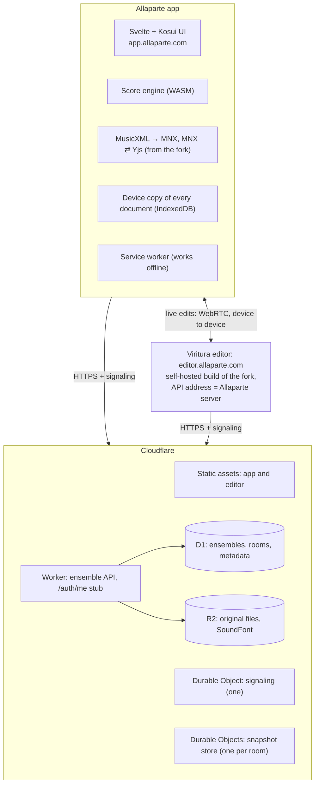

# Allaparte Design

> **Status:** Draft. Covers the viewer, ensembles, the workflow, annotations
> and the architecture. Open items are listed at the end.

## Summary

Allaparte is a free, open-source (MIT) web app for ensemble musicians.
Everyone reads from the same up-to-date score, and each musician controls how
their part looks on their own screen.

The name comes from _colla parte_, the instruction that tells an accompanist
to follow the soloist. In Allaparte, the score follows the player.

## Problem

Today the band reads PDFs, stored in Google Drive, in forScore on iPads.

1. **Annotations get lost.** Musicians mark up their PDFs. When the arranger
   publishes a revision, the markings stay on the old copy and have to be
   redone by hand.
2. **Layout is fixed.** A PDF has one staff size, one set of page breaks and
   one page size. Musicians can't adapt it to their eyesight, their device or
   their stand.

## Principle: the arranger owns the music, the musician owns the page

| Owner        | Controls                                                                           |
| ------------ | ---------------------------------------------------------------------------------- |
| Arranger     | Pitches (including spelling), rhythms, dynamics, articulations, text, cues, divisi |
| Musician     | Everything about how that music is drawn: layout, size, spacing, engraving choices |

The viewer renders the arranger's music with the musician's presentation. It
never uses the arranger's presentation choices, even when the file contains
them.

## What the viewer keeps and discards

MNX files can carry presentation information alongside the music. The viewer
sorts it into four categories.

### Discarded: page layout

- Page and system breaks: `scores[].pages[].systems[]`.
- Viritura vendor extensions under `scores[]._x.viritura`: `pageSetup`,
  `layoutBreaks` and `textFrames`.
- Manual positioning of text: `manualOffset` and `pagePosition`.

The layout engine paginates from scratch for the musician's screen and
settings.

The MNX is the single source of truth for a piece's title and credits. They
live in Viritura's metadata extension (`_x.viritura.metadata`: title,
subtitle, composer, lyricist, arranger), which survives stripping. The
MusicXML converter fills it only when called with
`includeVendorExtensions: true`.

### Discarded: engraving choices

- Stem directions.
- Slur and tie placement (above or below).
- Explicit beam groupings.
- Courtesy accidentals.

The engine applies standard engraving practice when these are absent; for
example, it beams notes automatically when a file has no explicit beams.
Musicians may later get preferences for some of these, such as "beam by beat"
or "always show courtesy accidentals."

### Starting points the musician can change: parts and staves

- `scores[]`: the full score and the individual parts.
- `layouts[]`: which parts go on which staves, plus brackets, braces and
  shared barlines.
- `useWritten`: whether a part shows written (transposed) or concert pitch.

Which parts a musician sees is their choice, like the rest of their layout.
They can pick any combination, such as their own part plus the vocal line as
a cue. The viewer builds that view by adding a layout and a score to the MNX
it renders; the engine needs no changes for this. The file's own scores and
parts are presets to start from.

### Kept: musical content

Pitches, rhythms, dynamics, articulations, text, cue notes, divisi and ossia
passages. Spelling is part of the pitch in MNX (F♯ and G♭ are different
notes), so the viewer keeps it.

### Presentation is stripped only when rendering

The shared file keeps the arranger's presentation. Allaparte strips it from
the copy it renders, so the arranger's engraving survives in the file, for
printing and for editing in a notation editor.

### The shared file can change

Musical content can change after import. In rehearsal, an ensemble may want a
quick fix that everyone sees right away, such as correcting a wrong note or
moving a passage up an octave. This is a future feature.

There is one copy of each score: a Yjs document with the same structure
Viritura uses for live collaboration, a direct projection of the MNX JSON.
Quick fixes happen in Allaparte; anything bigger happens in the Viritura
editor, which opens the same document. Edits appear live in both, so there is
no export and re-import, and nothing to merge.

Arrangements written in MuseScore come in once, by MusicXML import. After
that, the piece lives in Allaparte and Viritura.

## Ensembles and access

In the first version, an ensemble is a library of music and setlists with
one generated link. Everyone with the link can do everything; there are no
accounts or roles. Each device asks for a name, so personal settings have an
owner.

Until there are logins, only the operator can create ensembles, using an
operator script. Losing the link means losing access to the ensemble, though
the operator can look it up with the same script.

Ensembles bring their own arrangements and are responsible for what they make
available.

Because anyone can edit:

- Recent mistakes can be undone with Yjs's UndoManager. On each device it
  undoes that device's own edits in the current session; the Viritura editor
  has its own undo. Version history comes later.
- The viewer opens in view mode. Editing is a mode you switch into, so a
  stray touch on a music stand doesn't change the shared score.

Later, people sign in and belong to ensembles, and can keep personal
setlists alongside the ensemble's shared ones.

## Workflow

1. **Create an ensemble.** The operator runs the operator script, which
   creates the ensemble and prints its link. Share the link with the
   band.
2. **Import pieces.** Drop MNX or MusicXML files (`.musicxml` or `.mxl`, full
   scores rather than separate parts) onto the ensemble. The browser converts
   MusicXML to MNX and shows the title and credits (editable, saved into the
   MNX), the parts found, any converter warnings, and a preview. On
   confirmation it becomes a piece, and the original file is kept.
3. **Build setlists.** Order pieces into shared setlists, with optional set
   breaks and short notes.
4. **Musicians join.** They open the link, enter a name, and choose what to
   see in each piece. A choice carries over to other pieces by part name, so
   "Trumpet 1" finds "Trumpet in B♭ 1" or "Tpt. 1"; they adjust it where it
   doesn't.
5. **Prepare for offline.** While online, the app downloads every piece and
   shows which are ready offline. Musicians install it on their Home Screen.
6. **Rehearse and perform.** Open a setlist, tap a piece, and it opens with
   your parts and settings. Turn pages with a tap or a Bluetooth pedal.
7. **Fix things.** Quick fixes in Allaparte's edit mode (later); bigger
   changes in the self-hosted Viritura editor, on the same live document.

Bar IDs are created once, at import, and everything after that relies on
them. A chart revised in MuseScore after import can, for now, only replace
the piece, which discards edits made in Allaparte.

## Musician view settings

A musician's settings are stored in the ensemble under their name, so they
follow the name to any device.

**First version**

- Parts shown: any combination.
- Paged or scrolling view, whichever is simpler to build first; the other
  follows.
- Staff size.
- Light or dark display.
- Page size fitted to the device.

**Later**

- Showing an extra part at cue size.
- Showing or hiding cue notes.
- Written or concert pitch.
- Engraving preferences (beaming, courtesy accidentals).

### Page turns

Bluetooth page-turn pedals act as keyboards. The viewer turns pages on the
keys they send (arrow keys, Page Up and Page Down).

## Annotations

The first version keeps annotations as simple as possible:

- **Freehand ink only**, drawn with Apple Pencil in Safari.
- **Personal only.** Each musician's marks are theirs alone.
- **Stored on the device.** They don't follow the musician to another device,
  and they are lost if the browser's data is cleared.

Strokes are grouped so that a handwritten mark, such as a word written
across a barline, stays in one piece when the layout changes. A stroke
starts a new group if more than about 1.5 seconds have passed since the last
stroke, if it starts more than about 3 staff spaces from the current group,
or if the view has changed (scrolling, a page turn, zoom, a change of parts).
Otherwise it joins the current group. The numbers get tuned by feel in
testing.

A group attaches to the bar and staff closest to its first stroke. The anchor
point is stored as bar ID, part, beat within the bar, and vertical offset in
staff spaces, and the strokes are stored relative to it in staff spaces. Ink
then scales with the musician's staff size without stretching, and moves
with its beat when bars change width. A group hides when its part is hidden.

Shared layers (section bowings, the conductor's cuts) and typed marks come
later.

## Architecture

### Documents

Each ensemble has a **library document** (its pieces, setlists and members'
settings) and a **score document** per piece. Both are Yjs documents synced
the same way, and their IDs are Viritura room IDs (16 characters from
`a-z2-9`), so the editor can open a piece with `#live=<pieceId>`.

Every document is stored on the device first. The app opens from that copy,
fetches the server's snapshot when it can, and joins the live room when
others are online. Changes made offline merge when the device reconnects.

### Sync

Live edits travel device to device over WebRTC, which is what Viritura's
editor speaks, so the editor needs no changes. The server only introduces
peers (signaling) and holds a snapshot of each document. On Cloudflare, a Mac
and an iPad on the rehearsal Wi-Fi and an iPhone on LTE all connected, and
edits reached every device in under 100 ms (see [the Cloudflare
spike](spikes/cloudflare-live.md)).

The alternative is Yjs over WebSocket, with the server holding each
document. It avoids WebRTC's weak points (device-to-device connections on
venue Wi-Fi, the snapshot store, the 256 KB first-sync limit) but needs a
fork patch so the editor can use it. It is the fallback if WebRTC proves
unreliable, and Cloudflare supports it.

### Server on Cloudflare

Allaparte runs on Cloudflare rather than a VM, so there is no machine to
maintain: no OS updates, TLS, backups or restarts. A single Hetzner VM was the
alternative: plain Node with no platform-specific code, at a similar cost, but
with ongoing maintenance. The expected cost is the Workers Paid plan's $5 a
month minimum; the paid plan's per-request CPU limit is needed for merging
large snapshots.

- **Static assets:** the app is served by Allaparte's Worker, and the
  self-hosted Viritura editor by a Worker of its own that has no code.
- **WebRTC signaling** (`/live/signal`): one Durable Object holding every
  connection, using the WebSocket Hibernation API so idle connections cost
  nothing. It is a single object because the editor connects to a fixed
  address and names its room only after connecting. It only introduces
  peers; edits never pass through it.
- **Snapshot store** (`/live/room/{roomId}/snapshot`): one Durable Object per
  room, so concurrent uploads are handled one at a time. It returns a
  document's latest state. On upload it merges the incoming state into the
  stored one (`Y.mergeUpdates`) rather than replacing it, and deletes any
  Viritura host claim (`_meta.hostClientId`), which would otherwise lock
  later editors out. The bytes live in the object's own storage, in 1 MB
  chunks.
- **Ensemble API** (a Worker): registers new pieces in an ensemble, and
  stores and returns original uploaded files (in R2).
- **`/auth/me`** (a Worker route): answers "signed out", because the
  self-hosted editor sends its account checks to Allaparte's server.
- **D1** (Cloudflare's hosted SQLite): ensembles, registered rooms and
  metadata. Postgres later, through Hyperdrive, if Allaparte needs to scale.

An **operator script**, run with Cloudflare's `wrangler` against D1, creates
ensembles and looks up their links. Until there are logins, it is the only
way to create one, and everything else requires a valid ensemble: signaling
and snapshots only accept rooms registered to an ensemble.

Durable Objects and D1 are placed in western North America, near the band
in Seattle.

### iPad

The first version runs in Safari, with Apple Pencil for annotations. A
hybrid app (a native shell around the web app) can follow. A fully native app
is only worth it if performance demands it.

## Rendering

Allaparte is a standalone Svelte app built with
[Kosui](https://kosui.kosolabs.com). It reuses Viritura's layout engine,
**`@viritura/score-engine`** (Rust compiled to WebAssembly), built from
Allaparte's Viritura fork.

The viewer around the engine (scrolling, zoom, page turns, the annotation
layer) is where Allaparte needs the most customization, so Allaparte has its
own. Viritura's framework-free `@viritura/score-viewer` is a reference for it,
and possibly a starting point.

Layout runs in the browser. The server never interprets MNX.

See [the monorepo spike](spikes/monorepo-vs-standalone.md) for why Allaparte
doesn't live in Viritura's repo, and [the live-editing
spike](spikes/viritura-live.md) for the sync design's evidence.

### The Viritura fork

Allaparte depends heavily on Viritura and maintains a fork of it (Viritura is
MIT-licensed). The fork is a Git submodule at `vendor/viritura`, and the
single source for everything Allaparte uses from Viritura: the layout engine,
the MNX-to-Yjs projection, the MusicXML converter, and the editor Allaparte
hosts. Pinning one commit keeps them consistent with each other.

The converter and projection are imported from the submodule's source. The
engine is built there by `pnpm build:viritura`, which needs Rust. Committing
the built engine or publishing it as a release would spare developers Rust,
but keeps binaries in Git history or adds a release for every change.

Allaparte relies on Viritura internals that upstream doesn't promise to keep
stable, such as the score's Yjs layout, the host claim and the live
endpoints. So the fork rebases onto upstream when a change is worth having,
not continuously, and each rebase is checked against the live-editing spike.

The fork has no patches for now: it is a pinned copy of upstream. Allaparte
patches it only after a problem has been reproduced in Allaparte itself and
working around it from outside would be harder. Changes that would suit
Viritura generally can be offered upstream.

The editor is hosted at editor.allaparte.com, unmodified. Its built-in content
security policy allows only Viritura's servers and its own address, so
Cloudflare routes give Allaparte's Worker the editor's server paths on that
same address: its account check, live sessions, and the 119 MB SoundFont, which
is too large for static assets and is kept in R2.

| Need                                   | In Viritura today                        | Allaparte's approach                                         |
| -------------------------------------- | ---------------------------------------- | ------------------------------------------------------------ |
| Self-hosted editor uses Allaparte      | API address is a build setting           | Build the fork with Allaparte's server as its API address    |
| Ignore page layout, engraving choices  | No engine option                         | Strip them from the MNX before rendering (tested)            |
| MNX-to-Yjs projection                  | In unpublished `@viritura/crdt`          | Import from the fork                                         |
| MusicXML to MNX in the browser         | `@viritura/musicxml` is unpublished      | Import from the fork                                         |
| Stale host claims in durable pieces    | Editor claims host on its first edit     | Server and clients delete claims (tested); or patch the fork |
| Show any combination of parts          | Renders a layout from the MNX            | Add a reader layout and score to the rendered MNX (tested)   |
| Page turns placed for performers       | Not supported                            | Patch the fork or request upstream                           |
| Octave clefs (guitar and bass 8vb)     | Converter adds an octave transposition the concert clef already carries | Known, not patched; a fix is on the fork's `parked/octave-clefs` branch |
| Hidden chord symbols                   | Converter imports MusicXML `<harmony print-object="no">` as visible | Known, not patched; a fix that keeps but doesn't draw them is on `feat/hidden-chord-symbols` |

Seven of the band's charts were converted from MuseScore and rendered. The
music itself comes through intact: in the five checked note by note, every
note, grace note and tuplet matches MuseScore's MusicXML (13,186 notes in
all), extra voices on a staff are kept, and titles, composers, parts,
transposition, articulations, dynamics and key changes are right. Two bugs
affect most charts:

- **Octave clefs** appear in 4 of the 5 charts, for guitar and bass. Their
  notes and rhythm slashes are drawn an octave too high, colliding with chord
  symbols. MuseScore's concert-score export gives the octave both in the clef
  (treble-8vb, bass-8vb) and in `<for-part><part-transpose>`, and the
  converter applies both.
- **Hidden chord symbols** appear in 4 of the 5. The arranger repeats each
  chord on every guitar slash, hidden, so MuseScore's playback strikes it
  there; the converter shows them all, and they pile up.

Smaller issues: the converter's generated layout reorders staves (Allaparte
builds its own layouts, so this doesn't matter), a transposing part's label
repeats its key ("Bb Clarinet in B♭"), tempo and rehearsal marks can appear
above several staves, and one symbol in Quejas de Bandoneón renders as a
missing-glyph box. A score MuseScore considers corrupted can't be exported
at all until it's repaired in MuseScore.

## Open questions

- **Revised MuseScore files.** How does a new MusicXML export update a piece
  that already has edits and annotations? Needed before the band can rely on
  Allaparte. MuseScore's experimental MNX export keeps bar and note IDs
  stable across revisions, including inserted and deleted bars, so importing
  content from the MusicXML and IDs from the MNX makes revisions exact; parts
  match by name and position. Still to design: how a revision is applied to
  a piece with edits. See [the revisions spike](spikes/musescore-revisions.md).
- **Changes back to MuseScore.** Fixes made in Allaparte or the Viritura
  editor should be able to reach the arranger's MuseScore file. Importing a
  file into MuseScore creates a new score, so this may mean applying changes
  by ID rather than re-importing a whole file. Whatever the route, import must
  not drop anything the arranger authored, even what Allaparte never displays,
  such as hidden chord symbols.
- **Version history (later).** Restoring an old version can't replace the
  document with a snapshot: every device holding newer state would merge it
  back, undoing the restore. Applying the old version as new edits avoids
  that, but devices that were offline still merge their concurrent edits on
  top, which can partly bring back reverted content.
- **Settings scope.** Part choice is per piece; which other settings are per
  piece and which are global?

### To verify

- **Accidentals** come out right when the file's courtesy-accidental choices
  (`accidentalDisplay`) are removed. The spikes didn't strip them.
- **iPad storage** survives: installing to the Home Screen and requesting
  persistent storage (`navigator.storage.persist()`) keeps Safari from
  clearing device copies and annotations.
- **The app opens offline**, through its service worker. Not built yet.
